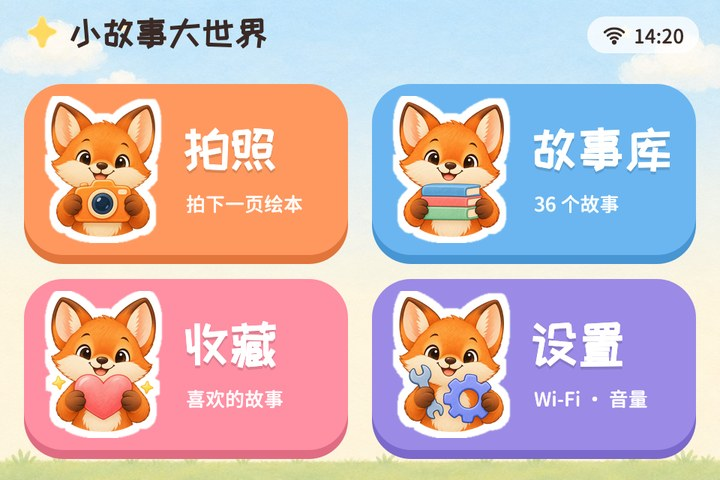
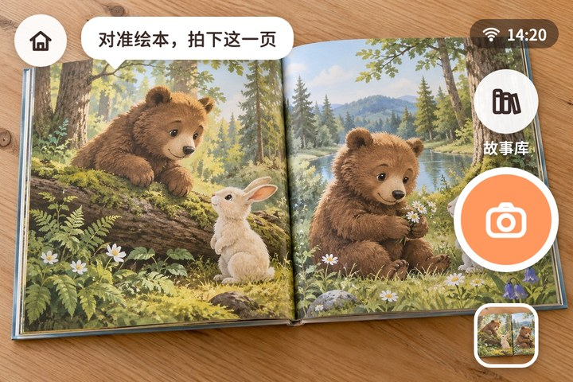
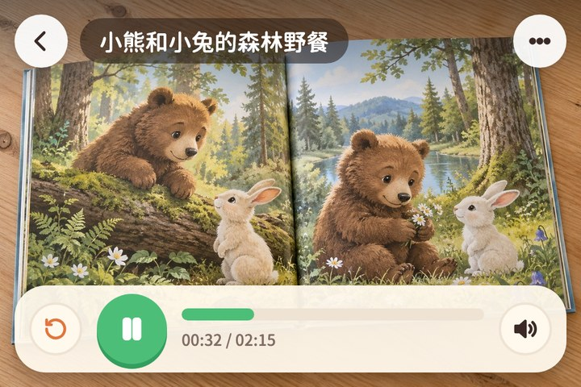

# esp32-story-camera

简体中文 | [English](README.md)

一台给小朋友用的 AI 绘本故事机，基于带摄像头和触摸屏的 ESP32-P4 开发板。
对准绘本的一页按下快门，小狐狸就会讲一个关于这一页的小故事：由视觉大模型看图写故事，
再用语音合成朗读出来。故事保存在 TF 卡里，没有网络也能反复听。

| 首页 | 拍照 | 播放 |
|---|---|---|
|  |  |  |

<sub>界面效果图（其中的绘本页为 AI 生成）。真机首页截图：[docs/images/device-home.png](docs/images/device-home.png)。</sub>

## 功能

- **拍一页，讲一个故事**：3:2 全屏拍照预览（约 28 帧/秒）；照片上传后端，视觉大模型按孩子年龄写故事，
  语音合成后设备下载、校验并自动播放。
- **故事库**：TF 卡离线回听、收藏、重新生成（保留旧版本），播放页左右滑动或点"上一个/下一个"切换，
  播完可自动播下一个。
- **适合孩子的界面**：大按钮、狐狸形象、点击与快门音效；批量操作需按住卡片 6 秒才能进入，删除前二次确认。
- **可靠性**：FAT 卡上的防断电写入（双槽元数据、删除意图、开机恢复扫描），上传幂等、生成可断点继续，
  TLS 证书校验始终开启。
- **自建后端**：FastAPI 服务，设备令牌、每日额度、测试用的 mock 供应商，附 nginx + systemd 部署模板。
- **设备上可设置**：Wi-Fi、孩子年龄、故事长度、音量、后端地址（域名或 IP）、存储空间。

## 工作原理

```
 ┌──────────── ESP32-P4 开发板 ────────────┐        HTTPS         ┌────────── 后端（server/） ─────────┐
 │ OV5647 → ISP → PPA → LVGL 界面 480×320  │  照片 + 设置         │ 设备认证 · 幂等 · 额度             │
 │ story_service：拍照 → 上传 → 轮询       │ ───────────────────▶ │ 视觉大模型：看图写故事             │
 │ → 下载 MP3 → 校验 → 播放（ES8311）      │ ◀─────────────────── │ 语音合成 → MP3 24kHz，-16 LUFS     │
 │ TF 卡：照片、故事、音频                 │  标题、正文、音频    └────────────────────────────────────┘
 └─────────────────────────────────────────┘
```

后端目前使用智谱开放平台 `glm-4.5v`（看图 + 写故事）与小米 MiMo `mimo-v2.5-tts`（朗读）。
供应商封装在 `server/app/providers/`，可以接入其他模型。界面与故事为简体中文。

## 硬件

| 部件 | 说明 |
|---|---|
| 微雪 ESP32-P4-WIFI6-Touch-LCD-3.5 | ESP32-P4（rev v1.x）+ ESP32-C6（Wi-Fi 6），32 MB PSRAM，16 MB Flash，3.5 寸 480×320 ST7796S SPI 屏，FT5x06 触摸，ES8311 音频 |
| OV5647 MIPI-CSI 摄像头模组 | 本板侧装，方向可配置（`STORY_CAMERA_ROTATION`） |
| 喇叭 | 接开发板功放输出 |
| TF 卡 | FAT32，8–32 GB |

## 目录

| 路径 | 内容 |
|---|---|
| `firmware/` | ESP-IDF v6.1 工程（LVGL 9.2）：界面、相机、存储、音频、网络、故事流程，见 [firmware/README.md](firmware/README.md) |
| `server/` | FastAPI 后端、测试、部署模板，见 [server/README.md](server/README.md) |
| `docs/api-contract-v1.md` | 设备与后端的接口契约 |
| `assets/` | 界面插画与图标（固件内 C 数组的源文件） |
| `tests/fixtures/` | 共用测试图片与契约响应样例 |
| `tools/` | UART 调试工具（截图、模拟点击、常驻串口会话） |

## 快速上手

### 1. 后端

需要[智谱开放平台](https://open.bigmodel.cn/)与小米 MiMo 开放平台（语音合成）的 API 密钥，
以及 Python 3.12+（已在 3.13 / 3.14 上测试）和 ffmpeg。

```bash
cd server
python3 -m venv .venv && .venv/bin/pip install -r requirements.txt
cp .env.example .env.local      # 填写 API 密钥与 SC_DEVICE_TOKENS（见下文"配对"）
```

设备只走 HTTPS。可以部署到有域名和 Let's Encrypt 证书的服务器（`server/deploy/`，nginx 监听 38800），
也可以在局域网用自签名证书联调（`server/scripts/gen_dev_certs.sh` + `server/scripts/run_dev.sh`）。
详见 [server/README.md](server/README.md)。

### 2. 固件

安装 [ESP-IDF v6.1](https://docs.espressif.com/projects/esp-idf/zh_CN/latest/esp32p4/get-started/)，然后：

```bash
cd firmware
idf.py menuconfig     # Story Camera → 后端地址与设备令牌（见"配对"）
idf.py build
idf.py -p <端口> flash monitor
```

### 3. 设备上

1. **设置 → Wi-Fi**：连接 2.4 GHz 网络（ESP32-C6 不支持 5 GHz）。
2. **设置 → 服务器**：填后端主机（域名或 IP）与端口，点"测试"，再点"保存"。
3. 对准绘本拍一页。第一次生成前需要家长确认"照片会上传用于生成故事"。

## 设备与后端配对

每台设备用 32 位十六进制令牌认证，后端只接受 `SC_DEVICE_TOKENS` 中登记的令牌。

1. 生成令牌：`python3 -c "import secrets; print(secrets.token_hex(16))"`
2. 固件：`menuconfig → Story Camera → Device token`（`CONFIG_STORY_DEV_TOKEN`）。
3. 后端：`SC_DEVICE_TOKENS=<令牌>:<设备名>`（多台设备用逗号分隔）。

令牌只在设备首次启动、NVS 里还没有令牌时写入。如果设备已经用空令牌启动过（会随机生成且不输出），
需要先擦除：`idf.py -p <端口> erase-flash`（会同时清除已保存的 Wi-Fi 和设置），再重新烧录。

## 开发说明

- `CONFIG_STORY_DEBUG_SILENT=y` 编译静音固件（功放常关），适合在安静场合调试。
- UART 调试控制台支持截图、模拟点击、切换页面、相机诊断等，见 [firmware/README.md](firmware/README.md#uart-调试控制台)。
- 后端测试：`cd server && .venv/bin/python -m pytest tests/`（mock 供应商，无需联网）。

## 现状与限制

- 在一块微雪 ESP32-P4-WIFI6-Touch-LCD-3.5（芯片 rev v1.3）+ ESP-IDF v6.1 上实机验证。
- 只有中文界面与故事，一种朗读音色。
- 暂不支持 OTA（单 factory 分区，USB 烧录）。
- 绘本照片会发送到你的后端以及你配置的 AI 服务商。给孩子使用前，请先了解服务商的使用条款与隐私政策。

## 许可证

[Apache License 2.0](LICENSE)。第三方组件、字体与生成内容见 [THIRD_PARTY_NOTICES.md](THIRD_PARTY_NOTICES.md)。
